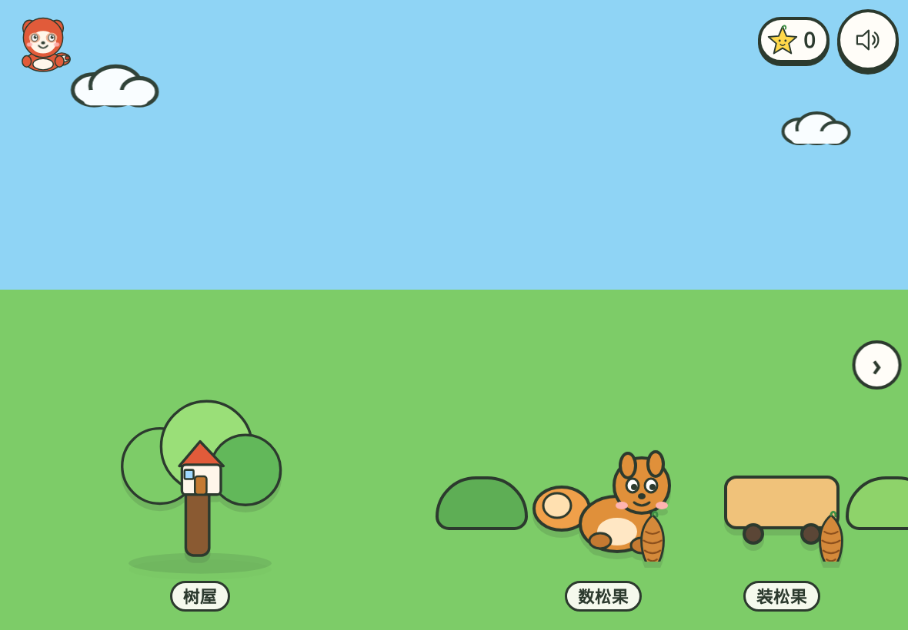
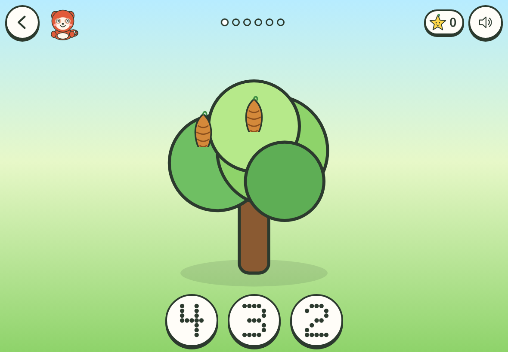
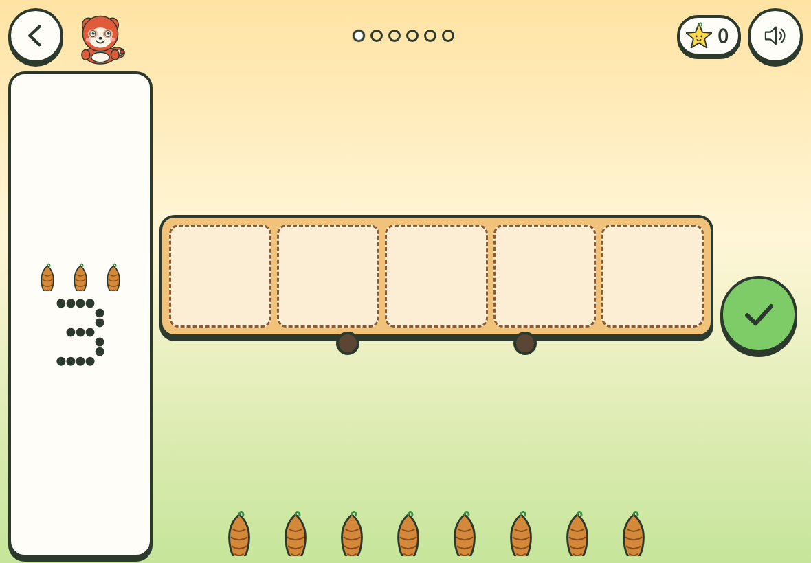
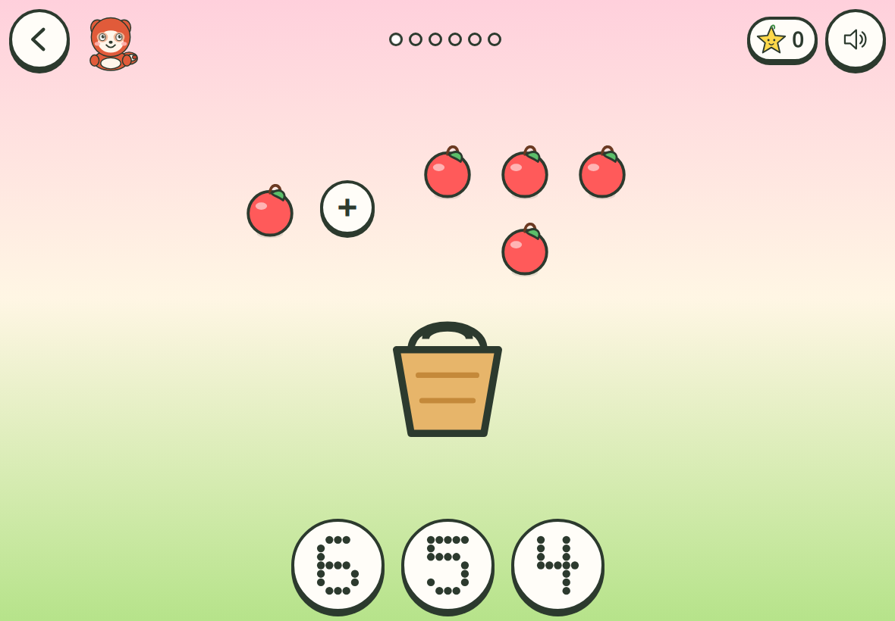
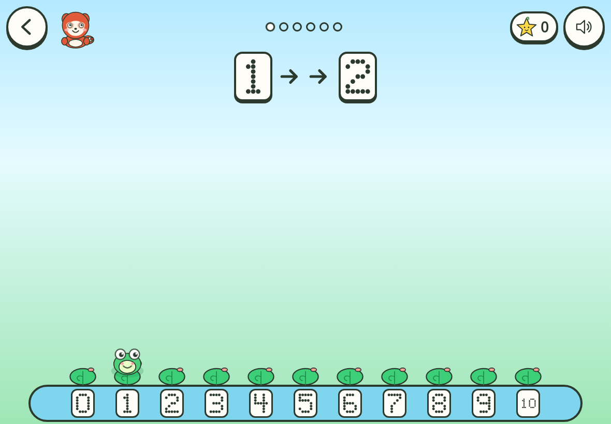
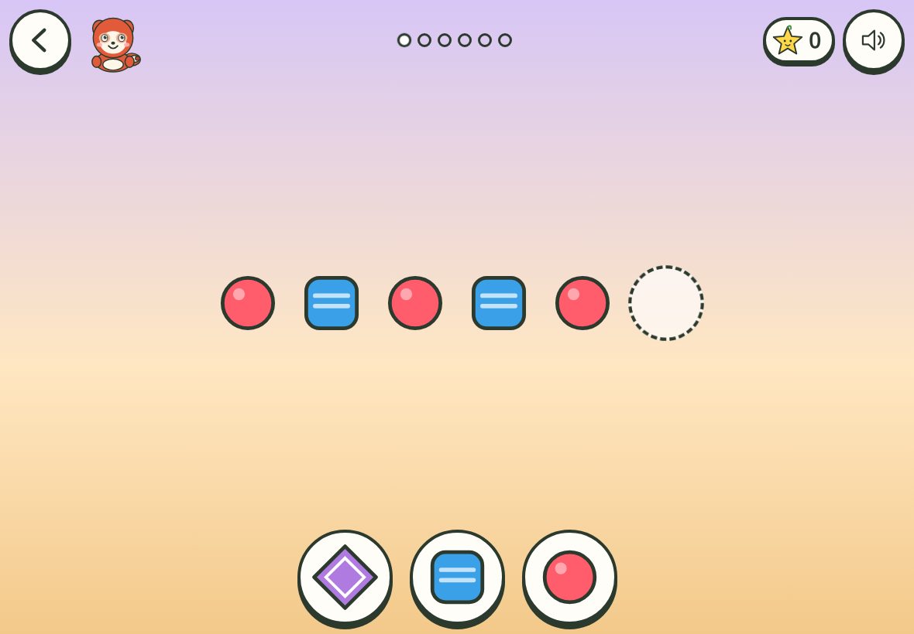

# 数字森林

给 5 岁小朋友的 iPad 数学小游戏。小熊猫 **团团** 住在森林里，陪孩子认数字、做 10 以内的加减、找规律。不需要识字，点按和拖动都很大，只鼓励、不扣分、没有倒计时。

这一版是可以玩的 MVP（计划里的 M0–M2）：森林地图和 5 个小游戏。进度存在这台设备上，不需要账号。


## 怎么玩

打开后先点大大的 **开始**。这一下会打开声音和中文语音（iPad 要求第一次出声必须由点击触发）。然后左右滑动森林地图，点一个地方进去。

每局 6 道小题。做完至少得到 1 颗星星果，全部第一次就答对得到 3 颗。星星果会让团团的树屋慢慢长出秋千、小鸟、花和灯笼。连对 3 题会稍难一点，连错 2 题会稍容易一点。

| 地方 | 玩法 |
|---|---|
| 数松果 | 点松果，团团会数「一、二、三…」，再从三个数字里选出一共有几颗 |
| 装松果车 | 小车是五格或十格框。看左边的样子或数字，把松果点进或拖进格子，再点绿色的勾 |
| 果篮 | 先来一些苹果，又来一些。点苹果可以一个个数，再选一共有几个 |
| 荷叶 | 呱呱站在数轴上。看箭头要往前或往后跳几下，点它落下的那片荷叶 |
| 找规律 | 珠子按形状排好（不单靠颜色），选出下一颗。难一点的时候改成数字规律 |

答错了团团会歪歪头，正确答案会亮一下，可以再试。每道题旁边的小喇叭可以再听一遍。右上角的星星果数字是已经收集的总数，点地图上的树屋可以看装饰和贴纸。










做完一局：


## 装到 iPad 上

用 **Safari** 打开：

<https://jollyfly.github.io/number-forest/>

点底部分享按钮 → **添加到主屏幕**。主屏幕上会出现团团图标，打开后全屏，没有地址栏。第一次打开需要联网；之后可以离线玩。

请把 iPad 侧面的 **静音开关关掉**，不然音效可能没有声音。系统里如果没有中文语音，游戏仍可以靠画面玩，开场会有一行小字说明。

想让孩子出不去这个画面，可以用 iPad 自带的「引导式访问」。想从系统层面限时，可以用「屏幕使用时间」。游戏自己的时长设置还在后面的版本里。

## 在电脑上运行

需要 Node.js 20 或更新。

```bash
npm install
npm run dev
```

浏览器打开终端里给出的地址。打包：

```bash
npm test
npm run build
npm run preview
```

页面路径是 `/number-forest/`，和 GitHub Pages 一致。

以后如果要用 Capacitor 套成原生 App（需要 Mac 和 Xcode），先用相对路径打包，再套壳。这一步现在还没做。

```bash
npm run build:ios
```

## 发布

推到 `main` 之后，GitHub Actions 会构建并发布到 GitHub Pages。仓库设置里需要把 Pages 的来源选成 **GitHub Actions**（见仓库所有者要做的那一步）。免费账号的 Pages 需要仓库是公开的。
